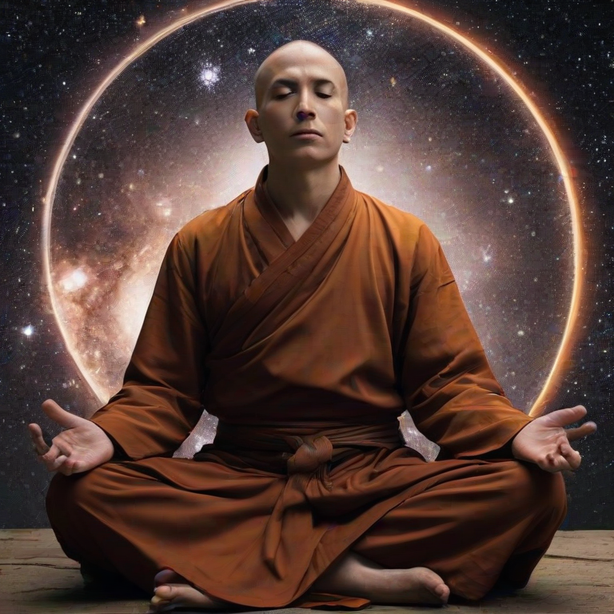

# ImageGenLocal

A fast, local platform for AI image creation.

[](https://opensource.org/licenses/MIT)
[]()

## 💡 Project Overview

This project provides a fully functional, local tool to generate high-quality images using local models, setup and used from HuggingFace. It allows users to generate content instantly without requiring external API calls, offering speed, privacy, and complete control over the generation process. 

## Tech Stack

| Component | Technology |
|---|---|
| Core | Python 3.10–3.12 |
| Image Generation | stable-diffusion.cpp |
| AI Framework | PyTorch, Hugging Face Diffusers |
| GPU Acceleration | NVIDIA CUDA 12 |
| Model Formats | GGUF, Safetensors |
| Model Hub | Hugging Face Hub |
| ML Libraries | Transformers, Accelerate, GGUF |
| Image Processing | Pillow |
| Frontend | HTML, CSS, Vanilla JavaScript |
| UI Framework | Bootstrap 5.3 |
| Backend Server | Python HTTP Server |
| Environment | Python Virtual Environment |

### Under the Hood

- **Native inference:** Prebuilt Windows CUDA binaries from stable-diffusion.cpp.
- **Automated setup:** Python handles environment creation, dependency installation, engine downloads and model management.
- **Model downloads:** Hugging Face Hub APIs with support for local checkpoints.
- **Memory management:** Automatic GPU/CPU offloading to accommodate limited VRAM.
- **Local execution:** Image generation, outputs and model storage remain on your machine.

### Prerequisites

*   Python 3.x
*   NVIDIA GPU (Recommended for performance)

### Running the Script

Execute the main Python script to start the application:
```bash
python <file-name>.py
```

---

### ⚙️ This is my own Current Setup
If you have a better setup, it will be faster. Don't recommend any rig below this.

| Component | Detail |
| :--- | :--- |
| **GPU** | **NVIDIA GeForce GTX 1660** |
| **VRAM** | **6 GB** |
| **CPU** | **11th Gen Intel(R) Core(TM) i5-11600 @ 2.80GHz (2.81 GHz)** |
| **RAM** | **16.0 GB** |

## 📸 Showcase

## The Tool

<p align="center">
  
</p>

## Output Images

<p align="center">
  
  
</p>

<p align="center">
  
  
</p>

<p align="center">
  
</p>
---

## 📄 License

This project is licensed under the [MIT License](LICENSE).
