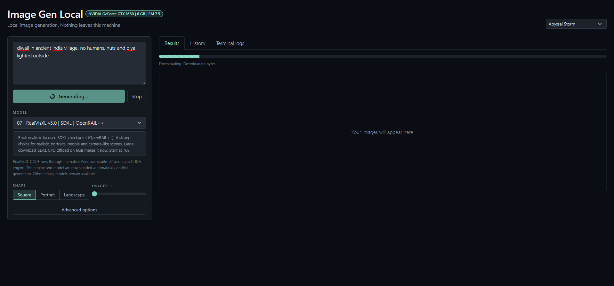
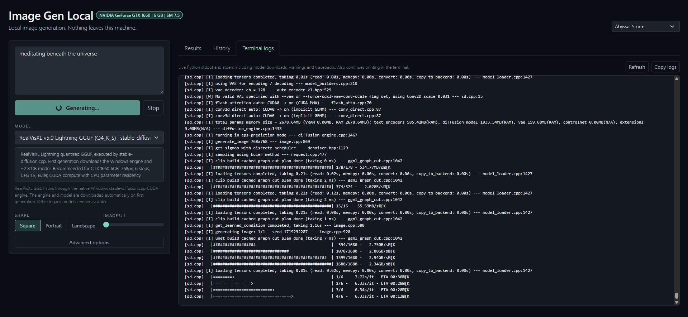
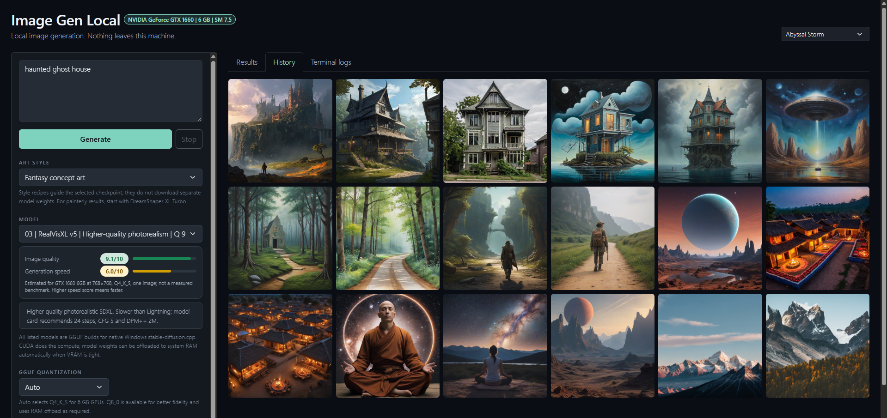
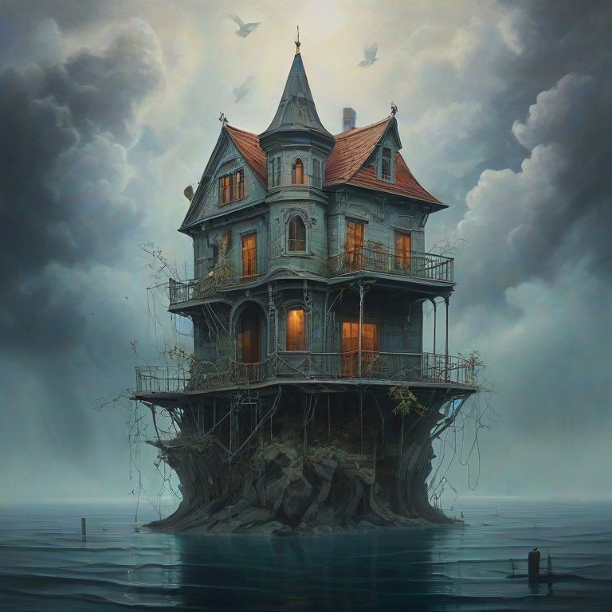
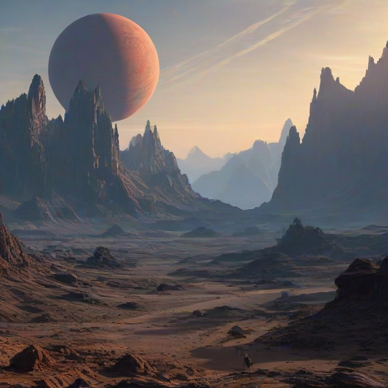
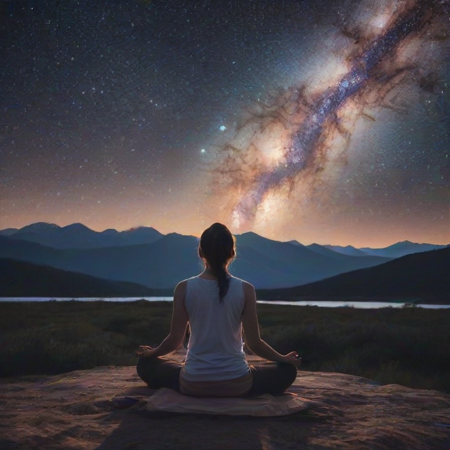

# ImageGenLocal

A fast, local platform for AI image creation.

[](https://opensource.org/licenses/MIT)
[]()

## 💡 Project Overview

This project provides a fully functional, local tool to generate high-quality images using local models, setup and used from HuggingFace. It allows users to generate content instantly without requiring external API calls, offering speed, privacy, and complete control over the generation process. 

**Core Goal:** To democratize AI image generation by making powerful models accessible directly on local hardware.

---

## 🚀 Tech Stack

*   **Model:** `[Any open source model]` (e.g., Stable Diffusion)
*   **Framework:** `[PyTorch/TensorFlow]`
*   **Libraries:** `[OpenCV, PIL, Transformers, etc.]`
*   **Interface:** `[Gradio/Streamlit]`

## ⚙️ Setup Guide

Follow these steps to get the project running locally.

### Prerequisites

*   Python 3.x
*   NVIDIA GPU (Recommended for performance)

### Running the Script

Execute the main Python script to start the application:
```bash
python generate.py
```

---

### ⚙️ This is my own Current Setup
#### If you have a better setup, it will be faster. Don't recommend rig below this.

| Component | Detail |
| :--- | :--- |
| **GPU** | **NVIDIA GeForce GTX 1660** |
| **VRAM** | **6 GB** |
| **CPU** | **11th Gen Intel(R) Core(TM) i5-11600 @ 2.80GHz (2.81 GHz)** |
| **RAM** | **16.0 GB** |

### ⬆️ Hardware Reccomendation

*   **Upgrade Target:** RTX 3060 (12GB VRAM) or higher.
*   **Benefit:** Enables faster generation and higher resolutions by increasing VRAM capacity.

## 📸 Showcase

**Visual Examples**

## Tools

<p align="center">
  
</p>
<p align="center">
  
</p>
<p align="center">
  
</p>

## Image Generations

<p align="center">
  
  
</p>

<p align="center">
  
  
</p>

---

## 📄 License

This project is licensed under the [MIT License](LICENSE).
